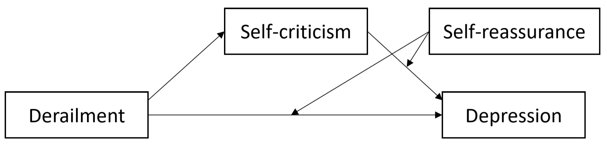

# Introduction and Dataset Description

Even a few demographic variables can be sufficient to uniquely re-identify a substantial proportion of participants in a typical psychological research dataset. This tutorial constitutes the online supplementary material to the article **Anonymization of Research Data for Open Science in Psychology**, which is currently under review and available as a preprint [hereafter cited as @Mueller_2026]. It guides the reader through the practical steps for reducing this re-identification risk. The tutorial provides a practical use case of how the anonymization techniques discussed in the main article can be applied to a real psychological research dataset. Although worked examples of specific anonymization methods exist, to the best of our knowledge no practical tutorial provides a step-by-step, end-to-end workflow for anonymizing psychological research data that realistically reflects the exploratory character of the anonymization process without suggesting a one-size-fits-all solution. We provide guidance on implementing and comparing multiple anonymization strategies for datasets with features typical of psychological research, such as small sample sizes and several sensitive items.

The tutorial is structured as follows: first, the dataset to be anonymized is introduced, followed by an initial disclosure risk assessment. Subsequently, different statistical disclosure control methods are applied. Finally, the utility of the resulting anonymized datasets is evaluated and the results are discussed.

To illustrate the anonymization of a dataset in the context of psychological research, we utilized a publicly available dataset [@Colman_2020_Dataset] obtained from [PsychArchives](https://psycharchives.org/en/item/104307aa-f80f-4d84-87ce-05814aa24f85). The dataset originates from a study examining psychological risk factors for depression [@Colman_2024_Psychological] and contains sociodemographic variables as well as Likert scales measuring derailment, self-criticism, self-reassurance, and depression (see @tbl-variables).

| Variable | Description |
|:--------|:--------------|
| Age | Participant’s age in years |
| Sex | Participant's gender (coded as a binary variable): <br> "female", "male" |
| Occupation | Participant’s occupation status: <br> "employed", "retired", "student", "undisclosed", "unemployed" |
| Ethnicity | Participant’s ethnicity: <br> "asian", "black", "mixed", "undisclosed", "white" |
| Derailment¹ | - 10-item derailment scale <br> - rated 1 ("Strongly disagree") to 5 ("Strongly agree") |
| Self-Criticism²| - 14-item self-criticism scale <br> - rated 0 ("Not at all like me") to 4 ("Extremely like me") |
| Self-Reassurance²| - 8-item self-reassurance scale <br> - rated 0 ("Not at all like me") to 4 ("Extremely like me") |
| Depression³ | - 9-item depression scale <br> - rated 0 ("Not at all") to 3 ("Nearly every day") |

: Description of variables included in the dataset {#tbl-variables}

¹ @Burrow_2020_Derailment,
² @Gilbert_2004_Criticizing,
³ @Kroenke_2001_PHQ9

For the purpose of demonstrating anonymization techniques, we exclusively used the raw data from the dataset. Specifically, we removed all standardized variables as well as any derived variables, such as composite scale scores calculated from the Likert items. Following the original study, we treat the scale scores as continuous variables, whereas the individual items are treated as ordinal. Although the originally published data has already been de-identified by deleting all direct identifiers, we will here demonstrate a more comprehensive approach to anonymization.

First, we load the required R packages. Although we introduce the reader to the most relevant functionalities of these packages, it is not possible to provide a full description of all their features. For details not covered in this tutorial, please consult the respective documentation. For classical anonymization methods, we use the R package `sdcMicro` [@Templ_2015_Statistical], a well-established, state-of-the-art open-source tool that provides a wide range of data anonymization techniques. The required dataset is loaded by sourcing the R script `Data_Preparation.R`, which imports the dataset as an R data frame named `data` and creates several auxiliary R objects used in subsequent analyses.

```{r load packages and data}
#| message: false
#| code-fold: false

# load required packages
library(sdcMicro)   # traditional anonymization methods
library(jtools)     # plotting regression results
library(clue)       # required by sdcMicro::recordLinkage()

# load and prepare dataset
source("R/data_preparation.R")
```

```{r output-width}
#| include: false
# change width so that outputs are displayed more nicely
options(width = 90) # default width = 80
```

## Disclosure Scenario

The anonymization process begins with defining the disclosure scenario [see @Mueller_2026, Chapter 2.3]. In this tutorial, we focus on preparing a **Public Use File** (PUF) from a research dataset. A PUF is a version of the dataset that can be shared openly with the broader research community and the public, without restrictions. To make a dataset suitable for public use, anonymization is mandatory [see @Mueller_2026, Chapter 2.1]. This means that all direct and quasi-identifiers must be removed or transformed so that individual respondents cannot be re-identified, protecting their privacy and complying with ethical standards and legal regulations.

In this tutorial, we assume a conservative attacker scenario in which potential attackers possess extensive background knowledge about the participants (for example, because they are family members or coworkers). Specifically, they are assumed to know all quasi-identifier variables and may even be aware of whether the target individual participated in the study. For example, suppose a participant’s employer knows their age, ethnicity, and occupation and is also aware that they took part in a study on depression. If that combination of characteristics uniquely identifies a single row in the released dataset, the employer could infer the participant’s depression score.

In our specific scenario, the goal is twofold:

1)  To create a dataset that can be openly shared as a PUF, ensuring anonymity of participants.
2)  To enable other researchers to approximately **reproduce the multiple regression results** based on the path model reported in @Colman_2024_Psychological (see @fig-DAG). This means that while further anonymizing the data, we must carefully retain the necessary variables to maintain the integrity of the original analysis. Because the regression model in the original study does not include any quasi-identifier variables, one could opt for a simple solution by releasing only the sensitive variables required for the regression analysis. Since no quasi-identifiers would be present in such a dataset, there would be essentially no risk of re-identifying study participants. However, in psychological research it is common for quasi-identifiers such as sex and age to be included in the analysis. Therefore, we aim to demonstrate anonymization procedures that preserve, at least to some extent, the relationships between quasi-identifiers and the sensitive variables used in the regression analysis. This corresponds to Stage 2 data utility requirements (i.e., task-specific utility for a known analysis) with a limited extension into Stage 3 [cf. Table 3 in @Mueller_2026]. However, it should be noted that the methods described in the following tutorial, as well as any other anonymization technique, generally cannot guarantee that analyses conducted on the anonymized data, particularly those not part of the original study (Stage 3 and 4), will yield results identical to those obtained from the original dataset, as it is not possible to anticipate all potential analytical approaches users may apply.

```{r DAG}
#| label: fig-DAG
#| echo: false
#| out-width: "70%"
#| fig-cap: Path model reported in @Colman_2024_Psychological.


```
In the case of reproducing the multiple regression results reported in @Colman_2024_Psychological, disseminating all individual items would not be necessary. The scale scores for derailment, self-criticism, self-reassurance, and depression would suffice, as these were the variables used in the regression analyses. The individual items could therefore be omitted, which would also facilitate data anonymization by reducing the number of variables that need to be considered.

However, in this tutorial, we will also work with item-level data to illustrate a situation in which the items themselves are relevant for reproducibility — for example, when constructs are modeled as latent variables estimated from their constituent items. More generally, when working with psychometric scales, researchers need to consider whether releasing only scores is sufficient for reproducibility or whether item-level data are also required. The answer depends on how the measures are used in the analysis.

::: callout-note
As outlined in @Mueller_2026, Chapter 2.2, anonymization workflows require defining risk and utility thresholds for data release. In practice, establishing such thresholds can be challenging because both risk and utility depend on the selected measures and anonymization methods. Since these measures are often abstract, clear cut-off values may be hard to justify. Moreover, researchers may have limited access to institutional guidance on what constitutes an acceptable level of risk. Data protection offices, ethics committees, or legal counsel may not provide specific guidance on anonymization thresholds or may not have the expertise to assess the technical aspects of disclosure risk. As a result, researchers may have to make these decisions without clear institutional standards, making the definition of defensible risk thresholds a persistent challenge in the anonymization of research data. Early-career researchers should not be left to make such decisions on their own. Instead, research teams should take collective responsibility for them.
:::

## Anonymization Strategies

We will demonstrate two distinct strategies for anonymizing the quasi-identifier variables: a non-perturbative approach based on **global recoding** and **local suppression**, and a perturbative approach based on **data swapping**. In both cases, the sensitive items are additionally perturbed using rank swapping to reduce attribute disclosure risk. We first demonstrate how global recoding and suppression can be applied to reduce identity disclosure by creating a dataset that satisfies $k$-anonymity with $k = 3$ (@sec-recoding-suppression). Additionally, we present an alternative method based on data swapping techniques to perturb the dataset (@sec-swapping). To evaluate the effectiveness of each method, we will assess both disclosure risk [see @Mueller_2026, Chapter 2.4] — before and after anonymization — and data utility [see @Mueller_2026, Chapter 4], ensuring that the anonymized datasets remain useful for analytical purposes, in particular the reproducibility of the key findings of @Colman_2024_Psychological.

Before applying any of these methods, we first need to understand the data and assess the disclosure risk. To do so, the initial step is to identify the different types of variables in the dataset, including direct identifiers, quasi-identifiers, sensitive attributes, and non-sensitive variables [see @Mueller_2026, Chapter 2.3.1].

### Specify direct identifier variables

The dataset contains no direct identifiers, such as phone numbers, full names, or addresses. If such identifiers had been included, the first step in the anonymization process would have been to **remove them** entirely, as they pose an immediate risk of re-identification.

### Specify quasi-identifiers (key variables)

The variables `Age`, `Sex`, `Occupation`, and `Ethnicity` are classified as quasi-identifier variables because, although they generally do not uniquely identify individuals on their own, in combination they could be used to re-identify individuals in the dataset. For example, if an attacker knows that a specific individual — whom they know personally and therefore know their age, sex, occupation, and ethnicity — participated in the study, the attacker can filter the dataset using these quasi-identifier values. If only one record matches this combination of quasi-identifiers, the attacker can successfully link the record to the target individual.

We create an R object named `qi_vars` that contains the names of the quasi-identifiers. This object is used later to avoid repeatedly specifying these variable names.

```{r key variables}
# quasi-identifiers
qi_vars <- c("Age", "Sex", "Occupation", "Ethnicity")
```

### Specify sensitive variables

Sensitive variables contain confidential information that must be protected to avoid potential harm or stigmatization of individuals. In the dataset at hand, all items related to **depression, derailment, self-criticism**, and **self-reassurance** are classified as sensitive. If an individual were to be re-identified, revealing their responses on these items could have serious personal or social implications.

By designating certain variables as sensitive, we make an important assumption: they cannot be used for re-identification purposes, unlike the quasi-identifiers (i.e., age, sex, occupation, and ethnicity). This assumption is often reasonable, as it is unlikely that an adversary has access to detailed psychological responses for a given individual. However, a caveat must be noted: if an adversary already knows that someone has a high depression score, this information could potentially aid in re-identifying that person. In such cases, while no new information about depression is disclosed (since the adversary already knows it), other sensitive attributes — such as the derailment score — could be inadvertently revealed through re-identification.

For the purposes of this tutorial, we assume an adversary model in which potential adversaries do not have prior knowledge of individuals’ sensitive attributes. This assumption guides our risk assessment and the anonymization strategies we apply.

In the `Data_Preparation.R` script sourced at the beginning, R objects containing the names of all relevant sensitive variables have already been created.

- `depression_items`: contains the names of all depression items
- `derailment_items`: contains the names of all derailment items
- `self_cri_items`: contains the names of all self-criticism items
- `self_re_items`: contains the names of all self-reassurance items
- `sens_vars`: contains the names of all sensitive items together
- `score_vars`: contains the names of the score variables (i.e. depression, derailment, self-criticism, and self-reassurance) 

### Specify non-sensitive variables

An example of a non-sensitive variable is the participant number, which we have already removed for the purposes of this tutorial. In our case, the participant number does not contain any information that could be used to identify an individual, is not sensitive, and holds no analytical value. As such, it does not contribute meaningfully to the analysis or the anonymization process and can be safely discarded.

# Pre-Anonymization Risk Assessment

To obtain a first impression of the disclosure risk associated with the originally published dataset, we compute the $k$-anonymity [see @Mueller_2026, Chapter 2.4.1] of the original data. To do this, we first need to transform the data frame `data` into an `sdcMicro` object. This can be done using the function `createSdcObj()`. The function allows us to specify which variables are quasi-identifiers (via the `keyVars` argument) and which are sensitive variables (via the `sensibleVar` argument; for details, open the help page by typing `?createSdcObj` in the R console). 

::: callout-tip
`sdcMicro` has a built-in GUI for users who do not want to write code. This GUI app can be opened by executing `sdcApp()` in the R console.
:::

Since we are only interested in $k$-anonymity, it is not necessary to specify sensitive variables, and this argument can therefore be omitted. Using `print(sdcInitial, type = "kAnon")`, we then can display the number of cases that violate $k$-anonymity for different values of $k$ [see @Mueller_2026, Chapter 2.4.1]. As shown in the output below, 102 cases (approximately 95% of the dataset) violate 5-anonymity.

```{r kAnon before anonymization}
# creating the sdcMicro object with the assigned variables
sdcInitial <- createSdcObj(dat = data,
                           keyVars = qi_vars)

# calculate k-anonymity 
print(sdcInitial, type = "kAnon")
```

This indicates that 102 participants possess unique combinations regarding the quasi-identifiers (i.e., `Sex`, `Occupation`, `Ethnicity`, and `Age`) not shared by at least 4 (i.e., $k - 1 = 5 - 1 = 4$) other participants. For 88 participants (82%), 3-anonymity is violated. This indicates that these 88 participants have combinations of characteristics across the four quasi-identifier variables that are not shared by at least two other participants in the dataset. Furthermore, 60 participants (56%) violate 2-anonymity, meaning they are sample-unique — that is, no other participant shares the same combination of quasi-identifier values. In other words, approximately 56% of the participants could be directly identified if a potential adversary knows their `Sex`, `Occupation`, `Ethnicity`, and `Age`, as well as whether the individual participated in the study.

::: callout-important
According to @Colman_2024_Psychological, the published data represent only a subsample of all participants, as 12 individuals who did not complete all scales were removed. Consequently, the risk measures calculated in this tutorial likely overestimate the true disclosure risk, since an attacker cannot know whether a specific participant is included in the released dataset, even if their participation in the study is known.
:::

To better understand which combinations of quasi-identifiers lead to $k$-anonymity violations, we can inspect risky combinations using the function `riskyCells()`. The number of dimensions displayed can be controlled with the `maxDim` argument. Since we have four quasi-identifiers, we set `maxDim = 4`. The `threshold` argument allows us to set a threshold at which cell frequencies are considered to be unsafe. For example, setting `threshold = 1` flags all cells (defined by specific combinations of quasi-identifier values) that occur only once in the dataset as unsafe.

The results in @tbl-risky-cells indicate that the variable `Age` is the dominant contributor to disclosure risk. As can be seen from the first row of the table, 15 participants have a unique age. When `Age` is combined with additional quasi-identifiers, the number of unsafe combinations increases; for example, `Age` in combination with `Sex` results in 36 unsafe combinations. When all quasi-identifiers are considered simultaneously, we obtain 60 unsafe combinations. This number is equivalent to the number of sample-uniques identified in the $k$-anonymity analysis above. Typically, $k$-anonymity is applied to categorical variables, whereas in our case `Age` is numeric and therefore has many distinct values. The pattern in @tbl-risky-cells reflects the high granularity of `Age`, which results in numerous small or unique cells when combined with other quasi-identifiers. For the anonymization process, this implies that reducing the cardinality of `Age` (e.g., through recoding into age groups) should substantially lower the re-identification risk.

```{r risky cells}
#| label: tbl-risky-cells
#| tbl-cap: "Cells of quasi-identifier combinations with low frequencies that may pose identity disclosure risk."

riskyCells(sdcInitial, maxDim = 4, threshold = 1)
```

Although `Occupation` and `Ethnicity` individually show very few unsafe cells, suggesting that these variables are well represented across categories, the combination `Occupation` × `Ethnicity` results in 4 uniques. 

To gain deeper insight into which quasi-identifier variables contribute most to re-identification risk, the function `suda2()` can be used instead of `riskyCells()`. The *Special Unique Detection Algorithm* (SUDA) identifies minimal sample uniques — that is, the smallest combinations of quasi-identifier variables that render a record unique and therefore potentially re-identifiable [see @Mueller_2026, Chapter 2.4.1]. For each record, `suda2()` determines the number and combination of quasi-identifiers required to achieve uniqueness. The fewer variables needed, the higher the associated disclosure risk. @tbl-suda reports the contribution of each quasi-identifier to the overall re-identification risk. Consistent with the previous discussion, `Age` contributes the largest share to potential re-identification.

```{r suda}
#| label: tbl-suda
#| tbl-cap: "Variable-level contributions to identity disclosure risk based on record-level SUDA scores."

# calculate SUDA scores
sdcInitial <- suda2(sdcInitial)

# the SUDA contribution output is stored in:
sdcInitial@risk$suda2$attribute_contributions
```

Barplots of the categorical quasi-identifiers further illustrate the distribution of values within these variables (see @fig-qi_distr_before). As the distributions show, non-white ethnicities are severely underrepresented, which may increase the risk of re-identification. In addition, only a few participants reported being unemployed, which may also increase the risk of re-identification. Such a pre-anonymization assessment of potential disclosure risks can provide valuable insights into which variables are disclosive, thereby guiding the selection of appropriate anonymization strategies.

```{r QI distribution before, fig.width = 9, fig.height = 5, fig.align = 'center'}
#| fig.cap: "Distribution of selected quasi-identifier variables before anonymization. The distribution of the variable 'Age' is displayed as a bar plot rather than a histogram to facilitate the identification of age values that occur only once and therefore increase the risk of re-identification."
#| label: "fig-qi_distr_before"
#| code-fold: true

# variables to plot
vars <- c("Ethnicity", "Occupation", "Sex", "Age")

# set up layout
op <- par(mfrow = c(2, 2), 
          mar = c(5, 4, 2, 1))  # bigger bottom margin for rotated labels

for (v in vars) {
  x <- data[[v]]

  if (v == "Age") {
    ages <- seq(min(x, na.rm = TRUE), max(x, na.rm = TRUE), by = 1)
    tab  <- table(factor(x, levels = ages))
    labs <- names(tab)

    bp   <- barplot(tab, plot = FALSE)
    ylim <- c(0, max(tab, na.rm = TRUE))

    plot.new()
    plot.window(xlim = range(bp) + c(-0.5, 0.5), ylim = ylim)
    title(main = "Age", ylab = "Count")

    grid(nx = 0, ny = NULL, col = "lightgray", lty = "dotted", lwd = par("lwd"))

    barplot(tab, add = TRUE, axes = FALSE, xaxt = "n",
            col = "steelblue", border = NA)
    axis(2); box()

    step <- max(1, floor(length(labs) / 20))
    idx  <- seq(1, length(labs), by = step)
    axis(1, at = bp[idx], labels = labs[idx], las = 2, cex.axis = 0.8)

  } else {
   tab  <- sort(table(x), decreasing = TRUE)
    labs <- names(tab)

    bp   <- barplot(tab, plot = FALSE)
    ylim <- c(0, max(tab, na.rm = TRUE))

    plot.new()
    plot.window(xlim = range(bp) + c(-0.5, 0.5), ylim = ylim)
    title(main = v, ylab = "Count")

    grid(nx = 0, ny = NULL, col = "lightgray", lty = "solid", lwd = par("lwd"))

    barplot(tab, add = TRUE, axes = FALSE, xaxt = "n",
            col = "steelblue", border = NA)
    axis(2); box()

    axis(1, at = bp, labels = labs, las = 2, cex.axis = 0.8)
  }
}

par(op)
```


# Statistical Disclosure Control {#sec-sdc}

In this chapter, we demonstrate how the dataset can be anonymized using traditional methods. The methods presented are a selection of many valid approaches and were chosen based on their applicability to a broad range of microdata in psychological research and their relative ease of implementation. We first demonstrate how **global recoding** and **local suppression** can be used to reduce identity disclosure risk. Subsequently, we present **data swapping** as an alternative approach to reducing identity disclosure risk. In both cases, we demonstrate how re-identification risk can be assessed following anonymization.

To mitigate attribute disclosure [see @Mueller_2026, Chapter 2.4.2], we will apply rank swapping [described in @Mueller_2026, Chapter 3.2] to the sensitive items, whose scores were used as predictor variables for the regression models in the original study [@Colman_2024_Psychological]. By perturbing sensitive variables, an attacker can no longer be certain that the released dataset reflects the true value of a potential target.

## Global Recoding and Local Suppression of Quasi-Identifier Variables {#sec-recoding-suppression}

As discussed in the previous section, the dataset contains numerous $k$-anonymity violations. The goal of this section is, therefore, to reduce the risk of re-identification (i.e. identity disclosure) by producing a dataset that satisfies $k$-anonymity with $k = 3$ [@Mueller_2026, Chapter 2.4.1]. To achieve this, we first reduce the granularity of the quasi-identifier variables through **global recoding**. Subsequently, we apply **local suppression** to remove remaining values that still permit re-identification [both techniques are discussed in @Mueller_2026, Chapter 3.1]. These methods are implemented using the R package `sdcMicro`, which provides built-in support for them.

Because the `Age` variable has been identified as a primary contributor to re-identification (see @tbl-suda), we will address it first. In the following step, the variable `Age` will be recoded into broader age categories. We can use the `sdcMicro::globalRecode()` function for this. The `column` argument specifies the variable to be recoded, and `breaks` defines the boundaries of the new age categories. In general, wider age bands reduce data utility (more information loss) but make re-identification based on age more difficult. In practice, the data custodian can test different breaks specifications and assess the impact on re-identification risk (e.g., using the $k$-anonymity evaluation shown earlier). As shown in the output below, recoding `Age` substantially reduces the number of $k$-anonymity violations; however, 22 cases still violate 3-anonymity, the threshold we set out to achieve.

```{r globalRecode}
# create a new sdcMicro object and specify the quasi-identifier variables
# `sdcReSu`: statistical disclosure control with recoding and suppression
sdcReSu <- createSdcObj(dat = data,
                        keyVars = qi_vars)

# As a first step, we will perform global recoding 
# on the variable Age to reduce its information content.
# For this, we group Age into 10-year categories, ranging from 10 to 80 years.
sdcReSu <- globalRecode(sdcReSu,
                        column = "Age",
                        breaks = seq(from = 10, to = 80, by = 10))

# calculate k-anonymity after the global recoding
print(sdcReSu, type = "kAnon")
```

::: callout-note
By applying anonymization techniques — such as `globalRecode()` — to the same `sdcMicro` object (e.g. `sdcReSu` in the example), risk measures such as $k$-anonymity are automatically updated. This enables the sequential application of multiple anonymization techniques to a dataset while evaluating disclosure risk and data utility after each step.
:::

Next, the values "Asian", "Black", "Mixed", and "Undisclosed" of the variable `Ethnicity` will be combined into a single category labeled "Other", as an attempt to handle their low frequencies (see @fig-qi_distr_before). If some categories are rare, this can increase the re-identification risk because it increases the likelihood for sample uniques. Similarly, the categories "Undisclosed" and "Unemployed" of the variable `Occupation` will be merged into one category, as only a few participants reported these characteristics. We want to emphasize that this form of recoding assigns ethnic minorities to a residual category, rendering them invisible in any subsequent analysis and marginalizing their presence [@Syed_2018_Invisibility]. There is therefore a tension between reducing re-identification risk and preserving the visibility of subgroups.

Because `Ethnicity` and `Occupation` are not numeric variables like `Age`, we have to use the `groupAndRename()` function instead of `globalRecode()` for recoding these variables. Using the function arguments `before` and `after`, we can specify which categories of a given variable should be recoded into a new category.

```{r recode ethnicity}
# Recode Ethnicity ("Asian", "Black", "Mixed", "Undisclosed" -> "Other")
sdcReSu <- groupAndRename(sdcReSu,
                          var = "Ethnicity",
                          before = c("Asian", "Black", "Mixed", "Undisclosed"),
                          after = c("Other"))

# calculate k-anonymity to check the effect of the recoding
print(sdcReSu, type = "kAnon")
```

As shown in the output, recoding `Ethnicity` had only a minor effect on $k$-anonymity. Only the number of 2-anonymous cases decreased from 16 to 14. In the following step, we recode the `Occupation` variable.

```{r recode occupation}
# Recode Occupation ("Unemployed", "Undisclosed" -> "Other")
sdcReSu <- groupAndRename(sdcReSu,
                          var = "Occupation",
                          before = c("Unemployed", "Undisclosed"),
                          after = c("Other"))

# calculate k-anonymity 
print(sdcReSu, type = "kAnon")
```

Recoding the `Occupation` variable did not affect the number of $k$-anonymity violations. Therefore, we can omit this recoding step with the function `undolast()` and retain the original `Occupation` values.

```{r undolast}
# Undo the last anonymization step (i.e., the recoding of occupation):
sdcReSu <- undolast(sdcReSu)
```

::: callout-tip
`undolast()` is a convenient function that allows the last anonymization step applied to an `sdcMicro` object to be undone. Utility and disclosure risk measures are reset accordingly, enabling quick testing of how different anonymization techniques affect the utility and disclosure risk of the dataset.
:::

Because 22 cases still violate the 3-anonymity requirement (including 14 that even violate 2-anonymity), we next apply local suppression. Values of the quasi-identifier variables will be suppressed where necessary to ensure that each equivalence class contains at least three records, thereby satisfying 3-anonymity. We enforce 3-anonymity using local suppression via the `kAnon()` function from the `sdcMicro` package. Local suppression replaces selected values in key variables with missing entries to ensure that each record shares its quasi-identifier pattern with at least $k-1$ other records. Using the `importance` argument, we can specify the priority of variables for local suppression. Here, we will treat `Age` as most important (i.e. as few suppressions as possible), followed by `Sex`, `Occupation`, and `Ethnicity`. The function `localSuppression()` would yield the same result, as it implements the identical algorithm under a legacy name.

```{r suppression}
# apply local suppression
sdcReSu <- kAnon(sdcReSu,
                 k = 3,            # level of k-anonymity
                 importance = c(2, # sex
                                3, # occupation
                                4, # ethnicity
                                1) # age
                 )

# reassess k-anonymity
print(sdcReSu, type = "kAnon")
```

As can be seen from the output, the re-identification risk is now greatly reduced by satisfying 3-anonymity. How many values had to be suppressed (i.e. deleted) to achieve 3-anonymity can be seen in the following output (@tbl-suppression). Most values were suppressed in the variable `Occupation`, followed by `Sex`.

```{r suppression info}
#| label: tbl-suppression
#| tbl-cap: "Overview of the number of suppressed values for each quasi-identifier variable"

# number of suppressions
print(sdcReSu, "ls")
```

We can validate the anonymization by inspecting the newly created dataset. The anonymized dataset can be extracted from the `sdcObject` using `extractManipData()`. The manipulated key variables can also be accessed directly from the object: they are stored in `sdcObject@manipKeyVars`.

```{r trad data extraction}
#| code-fold: true

# exchange real with anonymized values
data_ReSu <- data
data_ReSu[, qi_vars] <- sdcReSu@manipKeyVars
```

The barplots in @fig-qi_distr_after visualize the univariate distributions of the quasi-identifiers after anonymization. As can be seen, highly identifiable categories in `Ethnicity` (i.e., "Asian", "Black", and "Mixed") were recoded into the category "Other". Categories in `Occupation` and `Sex` were suppressed due to their low frequency. Consequently, compared to the distribution prior to anonymization (see @fig-qi_distr_before), a new "NA" bar is displayed. In addition, `Age` was recoded into seven categories, making it more difficult for a potential attacker to identify an individual based on exact age.

```{r distr-after, fig.width = 9, fig.height = 5, fig.align = 'center'}
#| fig.cap: "Distribution of selected quasi-identifier variables after anonymization"
#| label: "fig-qi_distr_after"
#| code-fold: true

# variables to plot
vars <- c("Ethnicity", "Occupation", "Sex", "Age")

# set up layout
op <- par(mfrow = c(2, 2), 
          mar = c(5, 4, 2, 1))  # bigger bottom margin for rotated labels

for (v in vars) {
  x <- data_ReSu[[v]]

   tab <- table(addNA(x), useNA = "ifany")
   names(tab)[is.na(names(tab))] <- "NA"
   labs <- names(tab)

    bp   <- barplot(tab, plot = FALSE)
    ylim <- c(0, max(tab, na.rm = TRUE))

    plot.new()
    plot.window(xlim = range(bp) + c(-0.5, 0.5), ylim = ylim)
    title(main = v, ylab = "Count")

    grid(nx = 0, ny = NULL, col = "lightgray", lty = "solid", lwd = par("lwd"))

    barplot(tab, add = TRUE, axes = FALSE, xaxt = "n",
            col = "rosybrown3", border = NA)
    axis(2); box()

    axis(1, at = bp, labels = labs, las = 2, cex.axis = 0.8)
}

par(op)
```


### Attribute Disclosure Risk {#sec-traditional-disclosure-risk}

Although the dataset now satisfies 3-anonymity, there remains a risk of **attribute disclosure**. In particular, an attacker may still be able to infer sensitive information when all individuals within an equivalence class — defined by identical quasi-identifier values — share the same value for a sensitive attribute [see @Mueller_2026, Chapter 2.4.2]. This risk can be assessed using the function `sdcMicro::ldiversity()`. By specifying a sensitive variable of interest, the function evaluates each equivalence class induced by the quasi-identifiers and computes the number of distinct sensitive values within that class. The resulting output summarizes the distribution of these diversity values across all individuals in the dataset.

If an equivalence class has an $l$-diversity value of 1, this indicates that all records in that class share the same sensitive attribute value, and the class therefore fails to provide protection against attribute disclosure. Higher values of $l$ indicate greater diversity and stronger protection. The function `ldiversity()` supports several variants of $l$-diversity (e.g., distinct or entropy-based). For further details see the R documentation by typing `?ldiversity` in the R console.

In the following code snippet, we calculate $l$-diversity for the first five sensitive variables.

::: callout-tip
The `ldiversity()` function can output results for a maximum of five sensitive variables simultaneously. If a user wishes to analyze more than five sensitive variables, the function must be executed multiple times using different subsets of sensitive variables.
:::

```{r ldiversity}
# calculate distinct l-diversity for the first 5 sensitive variables
ldiv_res <- ldiversity(sdcReSu,                     # sdcMicro object
                       ldiv_index = sens_vars[1:5]  # sensitive variables
                       )

# print results
print(ldiv_res@risk$ldiversity)

# optional: 
# inspect l-diversity for each record with:
# View(ldiv_res@risk$ldiversity)

```
As can be seen from the output above, although most equivalence classes exhibit some variability in the sensitive attribute, there are still cases (in each of the five variables) in which all individuals within an equivalence class share the same value of the sensitive variable, as indicated by a minimum $l$-diversity value of 1. This is not surprising, as the dataset contains many sensitive variables. In psychological research, where psychological constructs are often measured using psychometric scales comprising multiple, often highly sensitive items, enforcing $l$-diversity for each variable would likely result in substantial loss of data utility.

Because of this, we address attribute disclosure risk not by enforcing $l$-diversity but by applying rank swapping to the sensitive variables [see @Mueller_2026, Chapter 3.2]. We use rank swapping for several reasons. For each item, the marginal distribution remains intact, while correlations between items can, to some extent, be preserved. By relying on rank information, the ordinal nature of the items is taken into account, and values are swapped based on their proximity. The method is straightforward to implement, and the amount of perturbation can be controlled through a perturbation parameter.

However, determining the most appropriate approach for anonymizing psychometric scales remains an open area of research. Although we use rank swapping in this tutorial, other approaches, such as synthetic data generation, could be considered as well.

We apply rank swapping to each item using the `sdcMicro` function `rankSwap()`, ensuring that values are swapped primarily among observations with similar ranks. This way, even if all sensitive values within an equivalence class are identical, an attacker cannot know whether a response is original or swapped. The function `rankSwap()` allows specification of a multivariate preservation factor, `R0`, to maintain correlations between variables. The multivariate preservation factor is defined as the proportion $R_0 = R_1 / R_2$, where $R_1$ denotes the correlation between two variables after rank swapping and $R_2$ denotes the correlation prior to swapping. `R0` therefore controls the trade-off between data utility and disclosure risk: the closer `R0` is to 1, the better the correlations are preserved, but the fewer values are swapped. Because there is no universally correct value for `R0`, we compare two settings: `R0 = 0.98` (i.e., aiming to preserve approximately 98% of the original correlations), which prioritizes data utility, and `R0 = 0.70`, which introduces considerably more perturbation. Using the arguments `TopPercent` and `BottomPercent`, it is possible to specify the percentage of the largest and smallest values that are grouped together and replaced with their average before rank swapping is applied. We refrain from using this option by setting `TopPercent = 0` and `BottomPercent = 0`.

```{r rank swap sensitive items}
# Create a new dataset containing the modified quasi-identifiers
data_QI <- data
data_QI[, qi_vars] <- sdcReSu@manipKeyVars

# apply rank swapping to all items with R0 = 0.98
data_ReSu_98 <- rankSwap(data_QI,
                         variables = sens_vars,
                         R0 = 0.98,         # multivariate preservation factor
                         TopPercent = 0,    # no top coding
                         BottomPercent = 0, # no bottom coding
                         seed = 34)         # seed for reproducibility

# apply rank swapping to all items with R0 = 0.70
data_ReSu_70 <- rankSwap(data_QI,
                         variables = sens_vars,
                         R0 = 0.70,         # multivariate preservation factor
                         TopPercent = 0,    # no top coding
                         BottomPercent = 0, # no bottom coding
                         seed = 34)         # seed for reproducibility
```

To evaluate the impact of rank swapping, we compute the percentage of altered values across all sensitive items by contrasting the original and perturbed data for both values of `R0` (see @tbl-swap-pct).

```{r rankSwap assessment}
#| code-fold: true
#| tbl-cap: "Percentage of values of the sensitive items changed by rank swapping"
#| label: tbl-swap-pct

# create data frames containing pre- and post-swapped values
pre_swap      <- data[, sens_vars, drop = FALSE]
post_swap_98 <- data_ReSu_98[, sens_vars, drop = FALSE]
post_swap_70  <- data_ReSu_70[, sens_vars, drop = FALSE]

# cellwise change indicators
changed_98 <- (pre_swap != post_swap_98)
changed_70  <- (pre_swap != post_swap_70)

# total number of cells
n_cells <- length(as.matrix(pre_swap))

# percentages
pct_swapped_98 <- 100 * sum(changed_98, na.rm = TRUE) / n_cells
pct_swapped_70  <- 100 * sum(changed_70, na.rm = TRUE) / n_cells

knitr::kable(data.frame(R0 = c(0.98, 0.70),
                        `Values changed (%)` = round(c(pct_swapped_98, pct_swapped_70), 2),
                        check.names = FALSE),
             align = "c")
```

With `R0 = 0.98`, `r round(pct_swapped_98, 2)`% of the sensitive values were modified, whereas with `R0 = 0.70`, `r round(pct_swapped_70, 2)`% were modified. To get an idea of how much the values changed, @tbl-swap-diffs shows the distribution of the differences between the swapped and the original values (changed values only).

```{r rankSwap difference table}
#| code-fold: true
#| tbl-cap: "Size of changes in values of the sensitive items after rank swapping (changed values only)"
#| label: tbl-swap-diffs

# differences between post- and pre-swap values for changed cells only
diffs_98 <- (post_swap_98 - pre_swap)[changed_98 & !is.na(changed_98)]
diffs_70  <- (post_swap_70 - pre_swap)[changed_70 & !is.na(changed_70)]

# all change sizes occurring for at least one value of R0
change_levels <- sort(unique(c(diffs_98, diffs_70)))

# frequency tables of the change sizes
n_98 <- as.vector(table(factor(diffs_98, levels = change_levels)))
n_70  <- as.vector(table(factor(diffs_70, levels = change_levels)))

diff_tab <- data.frame(change_levels,
                       n_98, round(100 * n_98 / sum(n_98), 1),
                       n_70,  round(100 * n_70 / sum(n_70), 1))
names(diff_tab) <- c("Change (post − pre)",
                     "Number of values (R0 = 0.98)", "Share of changed values (%) (R0 = 0.98)",
                     "Number of values (R0 = 0.70)",  "Share of changed values (%) (R0 = 0.70)")

knitr::kable(diff_tab, align = "c")
```

To assess whether correlations between the sensitive items were preserved, we compared the correlation matrices before and after applying rank swapping. The absolute differences between the respective correlations are shown in @fig-cor-diffs. This will also be examined in more detail in the utility assessment @sec-utility below.

```{r cor differences}
#| fig.cap: "Absolute changes in Spearman correlations between the sensitive items after rank swapping with R0 = 0.98 (left) and R0 = 0.70 (right)"
#| label: "fig-cor-diffs"
#| fig-width: 8
#| fig-height: 4
#| code-fold: true

# correlation matrices before and after rank swapping
cor_before    <- cor(pre_swap, method = "spearman")
cor_after_98 <- cor(post_swap_98, method = "spearman")
cor_after_70  <- cor(post_swap_70, method = "spearman")

# absolute differences between correlations before and after swapping
cor_diff_98 <- abs(cor_before[lower.tri(cor_before)] -
                      cor_after_98[lower.tri(cor_after_98)])
cor_diff_70  <- abs(cor_before[lower.tri(cor_before)] -
                      cor_after_70[lower.tri(cor_after_70)])

# common breaks and y-axis so that both histograms are comparable
breaks <- seq(0, ceiling(max(cor_diff_98, cor_diff_70) * 20) / 20, by = 0.025)
y_max  <- max(hist(cor_diff_98, breaks = breaks, plot = FALSE)$counts,
              hist(cor_diff_70, breaks = breaks, plot = FALSE)$counts)

# plot
par(mfrow = c(1, 2))
for (res in list(list(cor_diff_98, "R0 = 0.98"), list(cor_diff_70, "R0 = 0.7"))) {
  hist(res[[1]],
       breaks = breaks,
       main = res[[2]],
       xlab = "Absolute differences",
       col = "steelblue",
       ylim = c(0, y_max),
       border = "white",
       cex.main = 0.8,
       cex.lab = 0.7,
       cex.axis = 0.7)
}
par(mfrow = c(1, 1))
```

The comparison illustrates the trade-off controlled by `R0`. With `R0 = 0.98`, the correlation structure is largely preserved (mean absolute change in correlations: `r round(mean(cor_diff_98), 3)`, maximum: `r round(max(cor_diff_98), 3)`). However, only `r round(pct_swapped_98, 2)`% of the values were changed, and all of them by just one item point. Consequently, an attacker who has re-identified a record can assume that each observed sensitive value is the original one with a probability of about `r round(100 - pct_swapped_98)`%, and even when a value was swapped, it deviates from the original response by only one point. With respect to attribute disclosure, this setting therefore provides only little protection. Furthermore, although values have been swapped at the item-level, the overall scores may still remain close to their true values.

With `R0 = 0.70`, `r round(pct_swapped_70, 2)`% of the values were changed. Although most changes still amount to one item point, some values were shifted by two or three points. This substantially increases the uncertainty for an attacker about whether an observed value corresponds to the original response. The price for this is a stronger distortion of the correlations between the items (mean absolute change: `r round(mean(cor_diff_70), 3)`, maximum: `r round(max(cor_diff_70), 3)`). Note that the differences in @tbl-swap-diffs are symmetric around zero for both settings: rank swapping exchanges values between records, so the marginal distribution of each item remains unchanged regardless of `R0`.

Which value of `R0` is appropriate depends on the specific utility and privacy-protection requirements. Note that, despite the application of rank swapping, some records may still violate the $l$-diversity criterion. However, the perturbation introduces uncertainty, meaning that a potential attacker can no longer be certain that an observed sensitive value corresponds to the original one. When data have been perturbed, users should be explicitly informed that the dataset does not represent an exact one-to-one correspondence with the original data.

Because the scale scores for the variables `Derailment`, `Self_Criticism`, `Self_Reassurance`, and `Depression` are derived from the items, they need to be recalculated after rank swapping to ensure that the score values remain consistent with the item-level data. For ease of use, the authors have already created a function, `create_scores()`, in `Data_Preparation.R` that recalculates the scores.

```{r rank swap final dataset}
# Recalculate the psychometric scores
data_ReSu_70 <- create_scores(data_ReSu_70)
data_ReSu_98 <- create_scores(data_ReSu_98)
data_original <- create_scores(data) # we will need this later

# environment cleaning
remove(data_QI, cor_diff_98, cor_diff_70, breaks, y_max, res)
```

@tbl-swap-scores shows how rank swapping at the item-level affected the scale scores. As expected, the magnitude of the changes depends on `R0`. The mean absolute changes (in standard deviations units) are larger for `R0 = 0.70` than `R0 = 0.98`. With `R0 = 0.98`, the changes were relatively small on average: the mean absolute change amounted to only 0.12 to 0.14 standard deviations of the original scores, and the Pearson correlations between original and swapped scores remained very high (r = 0.96 to 0.98). With `R0 = 0.70`, the mean absolute change increased to 0.30 to 0.39 standard deviations, and the Pearson correlations between original and swapped scores were noticeably lower (r = 0.80 to 0.93). From a privacy perspective, this means that with `R0 = 0.98`, an attacker who has re-identified a record can still infer a participant's scale scores fairly accurately, whereas with `R0 = 0.70`, the observed scores provide a considerably less reliable indication of the true values.

```{r rankSwap score changes}
#| code-fold: true
#| tbl-cap: "Changes in the scale scores after rank swapping"
#| label: tbl-swap-scores

# function summarizing the changes between original and swapped scores
score_change <- function(original, swapped) {
  abs_change <- abs(swapped - original)
  c("Scores changed (%)"       = 100 * mean(abs_change > 0),
    "Mean |change|"            = mean(abs_change),
    "Mean |change| (SD units)" = mean(abs_change) / sd(original),
    "Max |change|"             = max(abs_change),
    "r (original, swapped)"    = cor(original, swapped))
}

# apply the function to each scale score and both values of R0
score_tab <- NULL
for (s in score_vars) {
  score_tab <- rbind(score_tab,
    data.frame(Scale = s, R0 = "0.98",
               t(score_change(data_original[[s]], data_ReSu_98[[s]])),
               check.names = FALSE),
    data.frame(Scale = s, R0 = "0.70",
               t(score_change(data_original[[s]], data_ReSu_70[[s]])),
               check.names = FALSE))
}

knitr::kable(score_tab, digits = 2, align = "c")

# environment cleaning
remove(score_tab)
```


## Swapping of Quasi-Identifier Variables {#sec-swapping}

In the previous @sec-recoding-suppression, we applied **recoding** and **suppression** to the quasi-identifier variables to obtain a dataset that satisfies 3-anonymity. This classical approach [e.g. as proposed by @Morehouse_2025_Responsible] has the advantage of providing a framework for assessing re-identification risk through $k$-anonymity and attribute disclosure risk through measures such as $l$-diversity. However, a drawback of this approach is that recoding alters the set of possible values of variables, which can complicate comparisons between analyses conducted on the original and the anonymized datasets — especially in the context of releasing data for reproducibility purposes. For example, after recoding `Age` into age categories (e.g., 23 is recoded as "(20-30]"), the variable is no longer treated as numeric but as a factor variable in R. Consequently, direct comparison of regression coefficients becomes problematic, since the model specification changes. To enable meaningful comparison, the original data would need to be transformed using the same categorization scheme.

Furthermore, suppression — particularly when applied to multiple quasi-identifier variables — can substantially reduce data utility by introducing missing values into the dataset. While this reduces disclosure risk, it can create challenges for subsequent analyses. For example, when reproducing a regression model, suppressed values appear as missing data, meaning that standard estimation procedures (e.g., employing listwise deletion) restrict the analysis to observations with complete information, potentially reducing sample size, statistical power, and comparability with the original results. Although imputation can be used to address these issues, it further complicates the analysis.

We therefore present an alternative approach in this section that avoids recoding and suppression and uses **rank swapping** and **PRAM** instead [see @Mueller_2026, Chapter 3.2]. For this, we return to the original, unmodified dataset. To make it more difficult for an attacker to re-identify an individual, rank swapping is applied to the numeric variable `Age`, while PRAM is used for the categorical quasi-identifiers (i.e., `Sex`, `Occupation`, and `Ethnicity`). For the sensitive items, we apply rank swapping in the same manner as described in the previous section.

First, a new `sdcMicro` object is created with `Sex`, `Occupation`, and `Ethnicity` as categorical and `Age` as numeric key variable.

```{r sdcSwap}
# create a new sdcMicro object
#`sdcSwap`: statistical disclosure control with swapping
sdcSwap <- createSdcObj(dat = data,
                        keyVars = c("Sex", "Occupation", "Ethnicity"),
                        numVars = "Age")
```

Because `Age` is numeric, we will use rank swapping via the function `rankSwap()` to perturb its values. This method preserves the overall distribution of `Age` while altering individual values to reduce re-identification risk. As `Age` is the only numeric quasi-identifier in this dataset, no multivariate preservation factor `R0` needs to be specified, as was done in @sec-traditional-disclosure-risk. However, we can control the degree of perturbation with the function argument `P`. Specifically, `P` defines the range of ranks within which swapping is allowed and represents the percentage of records considered. The lower the value of `P`, the lower the degree of perturbation. Here, we choose a relatively low value of `P = 0.06` (users can try out multiple values and decide which yields the best results). Again, we set `TopPercent = 0` and `BottomPercent = 0` because we don't want to replace the top and bottom values with their average.

```{r rank swap age}
# apply rank swapping
sdcSwap <- rankSwap(sdcSwap,
                    variables = "Age",
                    P = 0.06,          # degree of perturbation
                    TopPercent = 0,    # no top coding
                    BottomPercent = 0, # no bottom coding
                    seed = 34)         # seed for reproducibility

# assess risk and information loss after applying rank swapping
print(sdcSwap, "numrisk")
```

The results show that 27.10% of the perturbed `Age` values remain too similar to their original values, as defined by standard deviation-based intervals around the original data [see @Mueller_2026, Chapter 2.4.2]. For these cases, age was not changed enough, which could still allow an attacker to use this information for potential re-identification. The information loss displayed in the output (IL1) corresponds to the sum of record-level relative differences between the original and perturbed values of `Age` [for details, see @MateoSanz_2004_Outlier, p. 203]. 

To obtain a more intuitive understanding of the effect of rank swapping, we visually compare the original and perturbed `Age` values. @fig-rankSwapping shows the effect of rank swapping on the variable `Age`. The blue dashed line represents the identity line (i.e., $x = y$). Points that lie exactly on this line (red dots) indicate cases where the age value remained unchanged after swapping. As we can see, only a few age values were not affected by the swapping. Because only a small number of cases were not swapped and the remaining quasi-identifying variables will also be swapped in the next step (using PRAM), this should not be a problem.

```{r rank swapping plot, fig.width=8, fig.height=7, fig.align='center', out.width='65%'}
#| fig.cap: "Age distribution before and after applying rank swapping"
#| label: "fig-rankSwapping"
#| code-fold: true

Age_swapped <- round(extractManipData(sdcSwap)$Age, digits = 0)

# create a scatterplot to compare the new and old age values
# if the age did not change, mark it as a red dot

# logical vector: TRUE if point is on the line
on_line <- data$Age == Age_swapped

# plot points not on the line (default color)
par(mar = c(4.5,4,2,0.1))
plot(data$Age[!on_line], Age_swapped[!on_line],
     xlab = "Original Age",
     ylab = "Swapped Age",
     main = "Rank Swapping Comparison for 'Age'")

# add points that are exactly on the line in red
points(data$Age[on_line], Age_swapped[on_line], col = "red", pch = 19)

# add the x = y line
abline(a = 0, b = 1, col = "blue", lwd = 2, lty = 2)
```

We can also compare summary statistics of the original and swapped age values to assess how well the overall distribution has been preserved.

```{r age distributions}
#| echo: false
#| label: tbl-age-distr
#| tbl-cap: "Age distribution before and after rank swapping"

# compare basic distribution metrics between new and old age values
rbind(
  Original = summary(as.numeric(data$Age)),
  Swapped  = summary(as.numeric(Age_swapped))
)

# environment cleaning
remove(Age_swapped, on_line)
```

As can be seen from @tbl-age-distr, rank swapping preserved the quartiles of the age distribution as well as the minimum and maximum values. At this stage, one could also examine whether rank swapping has produced implausible combinations of `Age` and `Occupation` (e.g., a very young retired person). We will conduct this check after applying PRAM below (see @fig-boxplots_mixed).

For the categorical variables `Sex`, `Occupation`, and `Ethnicity` we will now apply *invariant* PRAM [see @Mueller_2026, Chapter 3.2]. The function `sdcMicro::pram()` automatically constructs a transition matrix for each variable in a way that preserves, in expectation, the marginal distributions of the original data. Users who wish to specify a transition matrix manually could do so via the `pd` function argument (see `?pram` for details). However, we must proceed with caution, as `Age` and `Occupation` are related variables, and we don't want to create implausible combinations. For example, it would be implausible if, after applying PRAM, a 20-year-old were classified as retired. To avoid such inconsistencies, we will first create a new variable for age groups and then specify that occupations may only be changed within the corresponding age group. `pram()` can be provided with strata variables (via the `strata_variables` argument) so that PRAM is applied separately within each stratum.

```{r pram}
# extract data out of sdcObject
data_swap <- extractManipData(sdcSwap)

# Age should be an integer
data_swap$Age <- round(data_swap$Age, digits = 0)
    
# create age groups (so the pram function knows which age groups to use)
data_swap$age_group <- cut(
  data_swap$Age,
  breaks = c(0, 25, 40, 60, Inf), # other age groups would also be possible
  labels = c("0–25", "26–40", "41–60", "60+"),
  right = TRUE
)

# create the sdcMicro object
sdcSwap <- createSdcObj(dat = data_swap,
                        keyVars = c("Sex", "Occupation", "Ethnicity"),
                        numVars = "Age")

# apply pram with "age_group" as strata variable
set.seed(34) # for reproducibility
sdcSwap <- pram(sdcSwap,
                variables = c("Sex", "Occupation", "Ethnicity"),
                strata_variables = "age_group")
```

After applying PRAM, `sdcMicro` warns that the $k$-anonymity and risk assessments are no longer meaningful. This is because $k$-anonymity relies on the assumption that the quasi-identifier variables reflect the participants’ true values. After applying PRAM, however, this no longer has to be the case (see @sec-recordLinkage). We can double-check the frequencies after PRAM and compare them with the original dataset. The corresponding information is stored in the `sdcObject` under "pram", which we can inspect using the following code. As can be seen from @tbl-pram-compare, the univariate frequency distributions differ only slightly.

```{r pram-compare}
#| label: tbl-pram-compare
#| tbl-cap: "Comparison of category frequencies before and after applying PRAM"

# compare the frequencies of the original and anonymized datasets
get.sdcMicroObj(sdcSwap, "pram")$comparison
```

The percentages of changes can also be reported in the output (see @tbl-pram-summary). For example, 10.28% of the values in the variable `Sex` were changed through PRAM.

```{r pram-summary}
#| label: tbl-pram-summary
#| tbl-cap: "Number of category changes after applying PRAM"

get.sdcMicroObj(sdcSwap, "pram")$summary
```

After applying rank swapping and PRAM, we will conduct plausibility checks to ensure the data remain consistent. For example, `Age` should align with `Occupation` (e.g., a retired person is typically associated with a higher age). As can be seen in @fig-boxplots_mixed, the `Age` distributions align in the majority of the cases with the original data. Although one case in the anonymized dataset exhibits early retirement, this observation is not impossible, which is why we refrain from correcting it.

```{r boxplot mixed, fig.width=10, fig.height=6, fig.align='center', out.width='90%'}
#| fig.cap: "Age distribution across occupations in the original and perturbed datasets. Side-by-side boxplots illustrate how anonymization affects the central tendencies and variability of age within each occupational group."
#| label: "fig-boxplots_mixed"
#| code-fold: true

# create a dataset that combines original and anonymized data for plotting
orig_df <- data[, qi_vars]
orig_df$dataset <- "Original"

anon_df <- data_swap[, qi_vars]
anon_df$dataset <- "Perturbed"

combined_df <- rbind(orig_df, anon_df)

# create combined factor with desired order
occ_levels <- levels(factor(combined_df$Occupation))
order_levels <- as.vector(t(outer(occ_levels, 
                                  c("Original", "Perturbed"), 
                                  paste, sep = "_")))

combined_df$OccData <- interaction(combined_df$Occupation, 
                                   combined_df$dataset, sep = "_")
combined_df$OccData <- factor(combined_df$OccData, levels = order_levels)

# colors match dataset
cols <- ifelse(grepl("Original", levels(combined_df$OccData)), "white", "grey")

# boxplot with custom order
par(mar = c(4.5, 9, 2, 0.1))
bp <- boxplot(Age ~ OccData,
              data = combined_df,
              col = cols,
              yaxt = "n",
              las = 1,
              xlab = "Age",
              ylab = "",
              main = "Age by Occupation: Original vs Perturbed",
              cex.axis = 0.8,
              cex.lab = 0.9, horizontal = TRUE)

# add only occupation names centered between pairs
n_occ <- length(occ_levels)
centers <- tapply(seq_along(bp$names), rep(seq_len(n_occ), each = 2), mean)
axis(2, at = centers, labels = occ_levels, tick = FALSE, cex.axis = 0.8, las = 1)

# add legend
legend("topright",
       fill = c("white", "grey"),
       legend = c("Original", "Perturbed"),
       bty = "n",
       cex = 0.8)

# environment cleaning
remove(orig_df, anon_df, combined_df, 
       occ_levels, order_levels, 
       cols, bp, n_occ, centers)
```

Following the anonymization of the quasi-identifiers, the next step is to perturb the sensitive items in order to reduce the attribute disclosure risk. In this step, we follow the same approach as described in @sec-traditional-disclosure-risk and use `rankSwap()` for all items. As before, we create two versions of the dataset with different levels of perturbation (i.e., `R0 = 0.98` and `R0 = 0.70`). The effects of these perturbation levels on data utility are evaluated in @sec-utility.

```{r rank swap sensitive items 2}
# Create a new dataset that can be used later for the utility assessment
data_swap <- extractManipData(sdcSwap)

# delete unnecessary column
data_swap$age_group <- NULL

# apply rank swapping to all sensitive items with R0 = 0.98
data_swap_98 <- rankSwap(data_swap,
                      variables = sens_vars,
                      R0 = 0.98,             # multivariate preservation factor
                      TopPercent = 0,        # no top coding
                      BottomPercent = 0,     # no bottom coding
                      seed = 34)             # seed for reproducibility

# apply rank swapping to all sensitive items with R0 = 0.70
data_swap_70 <- rankSwap(data_swap,
                      variables = sens_vars,
                      R0 = 0.70,             # multivariate preservation factor
                      TopPercent = 0,        # no top coding
                      BottomPercent = 0,     # no bottom coding
                      seed = 34)             # seed for reproducibility

# Recalculate the psychometric scores
data_swap_98 <- create_scores(data_swap_98)
data_swap_70 <- create_scores(data_swap_70)

```

### Record Linkage {#sec-recordLinkage}

After perturbing quasi-identifiers, assessing re-identification risk via $k$-anonymity is not useful anymore. $k$-anonymity assumes observed quasi-identifier combinations correspond to real individuals, but perturbative methods break this link by generating profiles that may not represent actual persons. For example, PRAM can generate quasi-identifier combinations that did not exist in the original data. A record may be sample-unique in the released dataset, yet not represent any real person’s true attributes. As a result, equivalence class sizes in the perturbed data no longer reliably reflect actual linkage risk.

To evaluate re-identification risk in the perturbed dataset, we next assess the record linkage risk [see @Mueller_2026, Chapter 2.4.1]. We simulate a scenario involving a well-informed attacker who knows the true quasi-identifier values of all participants and is aware that their data are included in the released dataset. The attacker then attempts to match these quasi-identifier values to the records in the perturbed dataset in order to infer the sensitive variables. This is done by finding an optimal matching between the original and perturbed records, defined as the assignment that minimizes the total Gower distance across matched record pairs based on the quasi-identifier attributes.

This type of record linkage attack can be implemented using the `recordLinkage()` function (see `?recordLinkage` for details). The function requires the original dataset, the anonymized (i.e., perturbed) dataset, and the quasi-identifier variables (specified with `vars`) that the attacker uses for matching. The function then computes the global record linkage risk of the anonymized dataset. Because the attacker matches on the quasi-identifiers only, the result is identical for both versions of the dataset (`R0 = 0.98` and `R0 = 0.70`); we therefore use `data_swap`, which contains the perturbed quasi-identifiers before rank swapping of the items.

```{r recordLinkage}
# assess record linkage risk
recordLinkage_risk <- recordLinkage(data, data_swap,
                                    vars = qi_vars)
recordLinkage_risk
```
As shown in the output, the global re-identification risk across all records is 28.97%, implying that more than one in four records could potentially be linked correctly. Although this value may appear high, especially for a PUF, it has to be interpreted in light of the conservative attacker scenario described above. The scenario assumes a highly informed attacker, and the matching algorithm implemented in `recordLinkage()` is designed in a way that favors the attacker. In practice, a real attacker is unlikely to possess such extensive information. Accordingly, the estimated re-identification risk of 28.97% should be interpreted as an upper bound.

The mean distance reported in the output is the average Gower distance between matched record pairs. By setting `return_matrix = TRUE`, users can also access the full pairwise distance matrix. In addition, the object returned by `recordLinkage()` contains a table of all matched pairs, which can be accessed via `recordLinkage_risk$matches`.

To further reduce the re-identification risk, the degree of perturbation can be increased. For example, higher swapping rates could be used in rank swapping and PRAM. However, even if some linkage risk remains, an intruder who is aware that the data have been anonymized generally does not know which specific values were modified. As a result, a seemingly exact match cannot be interpreted with certainty as a correct identification. The additional application of rank swapping to the sensitive items further increases this uncertainty for the attacker.


# Utility Assessment {#sec-utility}

Finally, we address the pending question of how much data utility was lost through the anonymization of the dataset. In this chapter, we compare the analytical utility of the datasets generated using swapping techniques for both versions `R0 = 0.98` and `R0=0.70` (@sec-traditional-disclosure-risk). The procedure described in @sec-recoding-suppression is excluded from this comparison because the value domain of the quasi-identifiers was altered, which renders the comparisons of correlations between these variables less straightforward. Moreover, the sensitive variables remain identical to those produced in @sec-swapping, such that no additional insight would be gained from including this approach in the present evaluation.

To assess data utility, we first compare the univariate distributions of the original data with those of the anonymized datasets. Since the distributions of the quasi-identifier variables have already been examined (see @sec-recoding-suppression and @sec-swapping), we next compare the distributions of the score values for `Derailment`, `Self_Criticism`, `Self_Reassurance`, and `Depression`, which are used in the subsequent regression analyses.

The univariate distributions of the numeric variables are presented in @fig-densities. Compared with the original data, rank swapping preserved the distributions of the score values reasonably well. As expected, the version with less swapping (i.e., `R0 = 0.98`) more closely resembles the original distribution.

```{r density plots}
#| fig.cap: "Kernel density estimates illustrating the empirical distributions of each variable, allowing visual assessment of how well the anonymization approaches preserve the overall shape, central tendency, and variability relative to the original data."
#| label: "fig-densities"
#| code-fold: true

compare_density <- function(var,
                            col_original = 1,
                            col_swap_98 = 2,
                            col_swap_70 = 4,
                            lwd = 2) {

  x1 <- data_original[[var]]
  x2 <- data_swap_98[[var]]
  x3 <- data_swap_70[[var]]

  d1 <- density(x1, na.rm = TRUE)
  d2 <- density(x2, na.rm = TRUE)
  d3 <- density(x3, na.rm = TRUE)

  # shared x/y limits
  xlim <- range(d1$x, d2$x, d3$x, finite = TRUE)
  ymax <- max(d1$y, d2$y, d3$y, na.rm = TRUE)

  plot(d1,
       main = var,
       xlab = "", ylab = "Density",
       xlim = xlim, ylim = c(0, ymax),
       lwd = lwd, col = col_original)

  lines(d2, col = col_swap_98, lwd = lwd)
  lines(d3, col = col_swap_70,  lwd = lwd)
}

# plot: 4 panels plus 1 legend row at the bottom
op <- par(no.readonly = TRUE)
on.exit(par(op), add = TRUE)

layout(matrix(c(1, 2, 3, 4, 5, 5), nrow = 3, byrow = TRUE),
       heights = c(1, 1, 0.2))

par(mar = c(4, 4, 3, 1),
    xaxs = "i", yaxs = "i")

vars <- c("Derailment", "Self_Criticism", "Self_Reassurance", "Depression")

invisible(lapply(vars, compare_density))

# last row: legend only
par(mar = c(0, 0, 0, 0))
plot.new()
legend("center",
       legend = c("Original", "Rank Swapping R0=0.98", "Rank Swapping R0=0.70"),
       col = c(1, 2, 4),
       lwd = 2,
       bty = "n",
       horiz = TRUE,
       cex = 1.2)
```

Next, we compare the associations among the variables of interest to assess whether not only the univariate distributions have been preserved, but also the relationships between the variables. @fig-cor-plot shows the associations between variables in the original data as well as under the two rank swapping approaches. Associations between numeric variables (i.e., `Age`, `Derailment`, `Self_Criticism`, `Self_Reassurance`, and `Depression`) were computed using the Pearson correlation coefficient. Associations between numeric and binary variables (i.e., `Sex`) were likewise calculated using Pearson correlations (equivalent to point-biserial correlations). The association between `Sex` and `Occupation` was quantified using Cramér’s V, whereas associations between `Occupation` and numeric variables were measured using the correlation ratio (η), computed as $\sqrt{\frac{SS_{\text{between}}}{SS_{\text{total}}}}$. The quasi-identifier variable `Ethnicity` was omitted due to low variability in its values.

```{r fig.align='center', out.width='100%'}
#| label: fig-cor-plot
#| fig-cap: Comparison of variable associations among key psychological constructs and demographic variables in the original data and in two perturbed versions with different rank swapping settings (R0 = 0.98 and R0 = 0.70). Associations were computed using Pearson correlations for numeric–numeric and numeric–binary pairs, Cramér’s V for categorical-binary pairs, and the correlation ratio (η) for categorical-numeric pairs.
#| code-fold: true

# load association heatmap function
source("R/association_heatmap.R")

# select relevant variables
cor_vars <- c("Age", "Sex", "Occupation", score_vars)

# helper function for labels
draw_row_labels <- function(labels, title = "") {
    p <- length(labels)
    
    plot(
        NA, NA,
        xlim = c(0, 1), ylim = c(0.5, p + 0.5),
        xaxs = "i", yaxs = "i",
        axes = FALSE,
        xlab = "", ylab = "", main = title
    )
    
    text(
        x = 0.98, y = p:1,
        labels = labels,
        adj = 1, cex = 0.8
    )
}

# plot layout
layout(matrix(1:4, nrow = 1), widths = c(0.42, 1, 1, 1))

# save current plotting settings
op <- par(no.readonly = TRUE)

# column 1: labels only
par(mar = c(7, 0.5, 4, 0.2) + 0.1)
draw_row_labels(cor_vars)

# column 2: heatmap 1
par(mar = c(7, 0.5, 4, 0.5) + 0.1)
assoc_heatmap(
    data_original[, cor_vars],
    vars = cor_vars,
    title = "Original Data",
    show_y_names = FALSE,
    show_x_names = TRUE
)

# column 3: heatmap 2
par(mar = c(7, 0.5, 4, 0.5) + 0.1)
assoc_heatmap(
    data_swap_98[, cor_vars],
    vars = cor_vars,
    title = "Rank Swapping R0=0.98",
    show_y_names = FALSE,
    show_x_names = TRUE
)

# column 4: heatmap 3
par(mar = c(7, 0.5, 4, 0.5) + 0.1)
assoc_heatmap(
    data_swap_70[, cor_vars],
    vars = cor_vars,
    title = "Rank Swapping R0=0.70",
    show_y_names = FALSE,
    show_x_names = TRUE
)

# restore original plotting settings
par(op)

```

As shown in @fig-cor-plot, the dataset anonymized with PRAM and rank swapping at `R0 = 0.98` preserves the associations among the variables relevant to the original analysis well, with most values deviating only marginally from the original data. Under the less restrictive setting (`R0 = 0.70`), the distortions are more pronounced: in particular, the associations of `Self_Reassurance` with `Derailment`, `Self_Criticism`, and `Depression` are substantially attenuated (e.g., from `r round(cor(data_original$Self_Reassurance, data_original$Depression), 2)` to `r round(cor(data_swap_70$Self_Reassurance, data_swap_70$Depression), 2)` for `Depression`). In both anonymized datasets, the weak relationship between `Sex` and `Self_Reassurance` is overestimated.

To assess data utility further, we will re-estimate the regression coefficients from the original study using both the original and anonymized datasets. By comparing the resulting regression coefficients, we can evaluate the extent to which anonymization affects the results of the regression models. Larger discrepancies between the coefficients indicate a greater loss in data utility. We fit the two regression models from the original study to each dataset with the following R code. In the first model, depression was regressed on derailment, self-criticism, self-reassurance, and the interactions of self-reassurance with derailment and self-criticism. In the second model, self-criticism was regressed on derailment (cf. @fig-DAG).

```{r regressions}
# fit the regression models to all the datasets
# regression formulas
form1 <- Depression ~ (Derailment + Self_Criticism) * Self_Reassurance
form2 <- Self_Criticism ~ Derailment

# list with datasets
datasets <- list(
  original = data_original,
  swap98   = data_swap_98,
  swap70   = data_swap_70
)

# convenience function for fitting regression models
fit_reg <- function(df) {
  list(
    lm1 = lm(form1, data = df),
    lm2 = lm(form2, data = df)
  )
}

# fit regressions models and save output
models <- lapply(datasets, fit_reg)
```

As shown in @fig-coefs-depr and @fig-coefs-selfc, the dataset anonymized with rank swapping at `R0 = 0.98` reproduces the results from the original dataset well. In the depression model, the coefficient estimates and their confidence intervals are nearly identical to those from the original data, and only the association between `Derailment` and `Self_Criticism` (cf. @fig-coefs-selfc) is overestimated. Under the less restrictive setting (`R0 = 0.70`), the self-criticism model is reproduced similarly well, but the depression model is clearly affected: the coefficients of `Derailment`, `Self_Criticism`, `Self_Reassurance`, and the `Derailment × Self_Reassurance` interaction are attenuated toward zero, the confidence intervals of all coefficients now include zero, and the explained variance decreases from $R^2 = `r round(summary(models$original$lm1)$adj.r.squared, 2)`$ to $R^2 = `r round(summary(models$swap70$lm1)$adj.r.squared, 2)`$. The degree of perturbation should therefore not be treated as a fixed default but rather as a parameter that data providers must calibrate to balance disclosure risk reduction against the preservation of data utility. Perturbation should be sufficient to reduce disclosure risk to an acceptable level without substantially altering substantive conclusions.

```{r plot-coefs depression, fig.align='center', fig.width=8, fig.height=5, out.width='90%'}
#| fig.cap: "Comparison of regression coefficient estimates (with confidence intervals) for the depression model across the original dataset and the two perturbed datasets with different rank swapping settings (R0 = 0.98 and R0 = 0.70)."
#| label: "fig-coefs-depr"
#| code-fold: true

# Plot the regression coefficients
plot_coefs(models$original$lm1,
           models$swap98$lm1,
           models$swap70$lm1,
           model.names = c(
               paste0("Original ", "(R\u00B2","=",
                     round(summary(
                         models$original$lm1)$adj.r.squared, digits = 2), ")"),
               paste0("Rank Swapping R0=0.98 ", "(R\u00B2","=",
                     round(summary(
                         models$swap98$lm1)$adj.r.squared, digits = 2), ")"),
               paste0("Rank Swapping R0=0.70 ", "(R\u00B2","=",
                     round(summary(
                         models$swap70$lm1)$adj.r.squared, digits = 2), ")")
           ),
           legend.title = "Depression Model",
           point.shape = FALSE,
           point.size = 3,
           colors = c("black", "red3", "#4C72B0"))
```

```{r plot-coefs self-criticism, fig.align='center', fig.width=8, fig.height=5, out.width='90%'}
#| fig.cap: "Comparison of regression coefficient estimates (with confidence intervals) for the self-criticism model across the original dataset and the two perturbed datasets with different rank swapping settings (R0 = 0.98 and R0 = 0.70)."
#| label: "fig-coefs-selfc"
#| code-fold: true

plot_coefs(models$original$lm2,
           models$swap98$lm2,
           models$swap70$lm2,
           model.names = c(
               paste0("Original ", "(R\u00B2","=",
                     round(summary(
                         models$original$lm2)$adj.r.squared, digits = 2), ")"),
               paste0("Rank Swapping R0=0.98 ", "(R\u00B2","=",
                     round(summary(
                         models$swap98$lm2)$adj.r.squared, digits = 2), ")"),
               paste0("Rank Swapping R0=0.70 ", "(R\u00B2","=",
                     round(summary(
                         models$swap70$lm2)$adj.r.squared, digits = 2), ")")
               ),
           legend.title = "Self-Criticism Model",
           point.shape = FALSE,
           point.size = 3,
           colors = c("black", "red3", "#4C72B0"))
```

# Summary

The objective of this tutorial is to demonstrate several widely used anonymization techniques through their practical application to a real dataset derived from a psychological study. It is intended to enable researchers to systematically assess the disclosure risk associated with their data and to implement appropriate safeguards that permit data sharing while preserving participant confidentiality. In doing so, it offers a realistic end-to-end workflow that reflects the complexity of responsible data anonymization.

Each of the anonymization techniques presented in the tutorial has distinct strengths and limitations; none is universally optimal across all contexts. Although these techniques apply to a wide range of microdata and should therefore be useful in most cases, more complex data structures, such as longitudinal or hierarchical data, may pose an increased re-identification risk and make it more difficult to preserve data utility. In such cases, more tailored techniques may be required. The effectiveness and appropriateness of a given anonymization strategy depend on the specific characteristics of the dataset as well as the disclosure risk scenario. Consequently, this tutorial should not be understood as a universal blueprint for anonymizing research data, but rather as an introductory example that demonstrates how different methods can be implemented in R.

We first anonymized the dataset by applying recoding and suppression to the quasi-identifier variables to ensure $k$-anonymity with $k=3$ (@sec-recoding-suppression). To further mitigate attribute disclosure risk, sensitive variables were subjected to rank swapping (@sec-traditional-disclosure-risk). Although this procedure is well established in statistical disclosure control, it modifies the value domain and measurement scale of the affected variables. For example, the variable `Age` is no longer represented as an integer-valued variable but as a set of categorical age groups. If reproducibility is a primary objective, such transformations may complicate direct comparisons between analyses conducted on the original dataset and those performed on the anonymized version.

We therefore showed in @sec-swapping how the dataset can be anonymized using swapping techniques (i.e., rank swapping and PRAM). Because $k$-anonymity is no longer a meaningful criterion after applying swapping techniques to the quasi-identifier variables, we instead assess re-identification risk under an explicit adversarial model. Specifically, we estimate the probability of successful re-identification by simulating a potential attacker performing record linkage. As demonstrated, even small perturbations to the data can substantially reduce re-identification risk. Nevertheless, a number of high-risk records remain. To further mitigate the disclosure risk, the swapping rate could be increased, thereby introducing additional perturbation at the expense of data utility.

Finally, we compared the utility of two versions of the swapped dataset that differ only in the perturbation of the sensitive items (@sec-utility). With `R0 = 0.98`, the original results were reproduced closely (@fig-cor-plot, @fig-coefs-depr, @fig-coefs-selfc), but few item values were altered, limiting protection against attribute disclosure. With `R0 = 0.70`, considerably more values were changed, at the cost of attenuated associations and a poorly reproduced depression model.

Overall, the results illustrate the inherent trade-off between disclosure risk reduction and analytical utility. The final choice of method ultimately depends on the data provider’s tolerance for disclosure risk and the acceptable trade-off between risk reduction and data utility. The choice of an appropriate anonymization strategy should therefore be guided by the intended analytical use, the acceptable level of disclosure risk, and the structural properties of the dataset. 

# Software Environment {.appendix}

The tutorial was rendered with the R version and packages listed below. The exact versions of all packages are also recorded in the file `renv.lock` in the GitHub repository.

::: {.callout-note collapse = "true"}
## Session information (click to expand)

```{r}
#| label: session-info
sessionInfo()
```
:::

# Acknowledgement {.appendix}

This work was funded by the Swiss National Science Foundation with grant *"Harnessing event and longitudinal data in industry and health sector through privacy preserving technologies"* (grant number 211751). We thank the authors of the original study, @Colman_2020_Dataset, for providing access to their data, which served as the foundation for the examples in this tutorial.

# References {.appendix}

